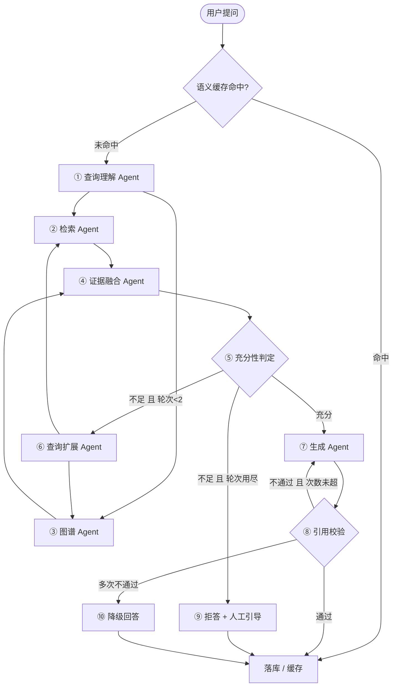

# v2 架构设计（课程答辩版）

> 状态：**Day1 已完成**（图引擎 + 10+ 节点 + SSE 轨迹 + Mock 适配器）
> 目标：1 周内交付可现场演示的课程答辩系统，之后平滑扩展为正常平台。

## 1. 答辩要求 → 实现映射

| 课程要求 | 实现 |
| --- | --- |
| 智能体设计、完整图构建、≥5 节点 | 13 个节点（11 个 Agent 节点 + 1 个并行分组 + 1 个终态节点），见 `app/agents/graph.py` |
| 至少 2 种控制结构 | 三种全有：并行（双路召回）、选择（缓存 / 充分性 / 引用校验）、循环（查询扩展重召回、引用校验重生成） |
| 完整前后端 | 后端 `backend/app`（FastAPI + SSE）；前端 `frontend/`（Vue3，Day3 开始） |
| 实际系统演示 | `/api/v1/chat` SSE 实时输出答案 + Agent 轨迹 |
| 不能用课程演示系统 | 自研系统，与毕设题目一致 |

## 2. 分层架构

```text
Vue3 SPA ── /api/v1/* + SSE ──> FastAPI (app/main.py)
                                     │
                          WorkflowEngine（并行 / 选择 / 循环 + trace）
                                     │
         11 个 Agent 节点（查询理解 / 检索 / 图谱 / 融合 / 充分性 / 扩展 /
                            生成 / 引用校验 / 拒答 / 降级 / 落库）
                                     │
        Services 适配器（Mock ⇄ Qdrant / Neo4j / MySQL / DeepSeek）
```

**关键原则**：节点只依赖适配器接口；切换真实存储只改 `.env` 的 `*_MODE`，节点代码不动。

## 3. Agent 图



## 4. 控制结构落点（答辩讲解用）

| 控制结构 | 图位置 | 演示看点 |
| --- | --- | --- |
| 并行 | 查询理解后 fan-out 到检索 / 图谱，`asyncio.gather` 汇合 | 轨迹面板两条分支同时 start，分支耗时分别展示 |
| 选择 | 缓存命中短路；充分性判定三分支；引用校验两分支 | 问“宿舍几点熄灯？”看缓存短路；问“今天天气怎么样？”看拒答分支 |
| 循环 | `check_sufficiency → expand_query → 并行召回`（≤2 轮）；`verify_grounding → generate_answer`（≤1 次） | 问“晚上不回寝室会怎样？”看扩展后第二轮召回；轨迹里两条 `route` 回到前序节点 |

循环有硬上限：`MAX_RETRIEVAL_ROUNDS`、`MAX_REGEN`、`MAX_STEPS`（全局步数）、单节点 `NODE_TIMEOUT`。

## 5. SSE 协议

| 事件 | 含义 |
| --- | --- |
| `meta` | 证据来源（融合后推送；缓存命中时带 `cached: true`） |
| `trace` | 节点轨迹：`{node, phase: start/end/route, kind, control, latency_ms, from, to, reason}` |
| `delta` | 大模型逐字增量 |
| `done` | 完整答案、来源、`refused/degraded/cached`、`runtime`（步数 / 访问节点 / 循环次数） |
| `error` | 终止错误 |

## 6. 目录

```text
backend/
├── app/
│   ├── main.py              # 应用工厂 + CORS + /health
│   ├── core/config.py       # Settings（模式开关 / 编排参数 / 三库配置）
│   ├── schemas/chat.py      # ChatRequest / ChatResponse / Evidence / SourceItem
│   ├── agents/
│   │   ├── state.py         # AgentState
│   │   ├── events.py        # EventBus（SSE 事件总线）
│   │   ├── runtime.py       # 图引擎（并行 / 选择 / 循环 + trace）
│   │   ├── graph.py         # 图定义（节点 + 路由）
│   │   └── nodes.py         # 节点实现 + Prompt
│   ├── services/            # Mock/真实适配器：llm / stores / persistence
│   └── api/v1/chat.py       # /api/v1/chat、/api/v1/graph
├── main.py                  # 旧极简版（现场回退）
└── tests/test_workflow.py   # 11 项图 + API 测试
```

## 7. 排期

| 天 | 内容 | 状态 |
| --- | --- | --- |
| D1 | 图引擎 + 10+ 节点 + SSE trace + Mock 适配器 + 测试 | ✅ 完成 |
| D2 | MySQL 真落库（会话/消息/反馈）+ 历史 API；Qdrant 本地模式 + BGE 小语料 | ⏳ |
| D3 | Vue3：登录 + 问答（SSE/轨迹/来源/反馈） | ⏳ |
| D4 | 会话历史 + 文档管理（上传/切分/入库）+ 联调 | ⏳ |
| D5 | Neo4j 真图（本地 Community）或 Mock 兜底 | ⏳ |
| D6 | 全链路彩排 + 种子数据 + 一键兜底 | ⏳ |
| D7 | PPT + 实验报告 + 演示视频脚本 | ⏳ |
